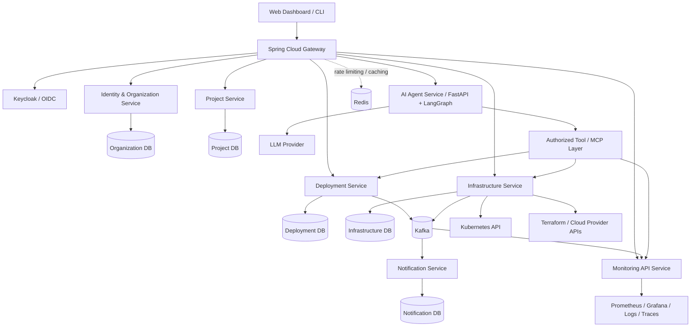
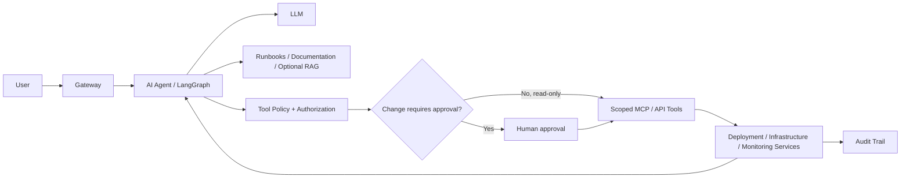

<div align="center">

# ☁️ CloudOps

### AI-Powered Cloud Infrastructure Management Platform

**Deploy · Manage · Monitor · Automate**

*A cloud-native, event-driven microservices project with an AI operations agent.*


</div>

> [!NOTE]
> **Project status: Planning / architecture design.** This README describes the target architecture and intended capabilities, not a completed or deployed product. Features and setup instructions will be updated as implementation progresses.

## 📖 Overview

**CloudOps** is a proposed self-service cloud operations platform inspired by the workflows of cloud consoles, deployment platforms, and observability tools. It aims to let developers manage projects, request deployments, provision controlled infrastructure resources, inspect system health, and interact with an AI operations assistant through a single interface.

The project is also a hands-on engineering lab for **Spring Boot microservices, distributed systems, DevOps, cloud infrastructure, and agentic AI**. It is designed to run incrementally on a development machine with **16 GB RAM**, with optional low-cost cloud experiments.

### 🎯 Goals

- Design independently deployable services with clear domain boundaries and data ownership.
- Build secure APIs with centralized authentication and role-based authorization.
- Combine synchronous REST calls with asynchronous domain events.
- Orchestrate deployment workflows reliably, including retries and failure recovery.
- Provide an AI agent that can **inspect, explain, propose, and request** infrastructure actions safely.
- Practice automated testing, CI/CD, containerization, Kubernetes, infrastructure as code, and observability.
- Keep the project approachable through phased implementation and selective local startup.

## ✨ Planned Features

| Area | Planned capabilities |
| --- | --- |
| Organizations & access | Users, organizations, memberships, roles, tenant isolation |
| Project management | Register applications, repositories, environments, deployment configuration |
| Deployments | Request deployments, track lifecycle, rollbacks, deployment history |
| Infrastructure | Manage approved resource templates and Kubernetes workloads through controlled adapters |
| Monitoring | Application health, metrics, logs, traces, deployment diagnostics |
| Notifications | Deployment status, failures, alerts, user notifications |
| AI operations assistant | Natural-language questions, troubleshooting, deployment plans, approval-based actions |
| Developer experience | Web dashboard, documented APIs, optional CLI |

## 🏗️ Target Architecture



**Architectural principles**

1. **Database per service:** Each service owns its schema/database and exposes its data through APIs or events; local development may share one PostgreSQL server with separate databases.
2. **Gateway as entry point:** Clients access application APIs through Spring Cloud Gateway. The gateway validates tokens; each service also enforces authorization for its own operations.
3. **REST for immediate operations, Kafka for events:** Use synchronous APIs when a response is needed and asynchronous events for state changes and background processing.
4. **No unrestricted AI execution:** The AI agent uses scoped tools to request operations. Backend services validate permissions, enforce policies, and record audit events.
5. **Kubernetes-native discovery in Kubernetes:** Eureka and Spring Cloud Config may be explored in a local learning phase, but are not mandatory for the Kubernetes deployment.
6. **Incremental infrastructure:** Start with a small local deployment and add components as their use cases emerge.

## 🧩 Service Catalog

| Service | Responsibility | Proposed stack |
| --- | --- | --- |
| API Gateway | Routing, token validation, edge rate limits | Spring Cloud Gateway |
| Identity & Organization | Organizations, memberships, role assignments | Spring Boot, PostgreSQL |
| Project | Projects, environments, source repositories | Spring Boot, PostgreSQL |
| Deployment | Deployment lifecycle, jobs, rollback coordination | Spring Boot, PostgreSQL, Kafka |
| Infrastructure | Approved resource provisioning and workload operations | Spring Boot, Kubernetes API, Terraform adapters |
| Monitoring API | Aggregate metrics, logs, traces, and health data | Spring Boot, observability integrations |
| Notification | Process deployment/alert events and send notifications | Spring Boot, Kafka, PostgreSQL |
| AI Agent | Natural-language operations, planning, diagnostics, tool orchestration | Python, FastAPI, LangGraph |

**Identity provider:** Keycloak handles authentication and issues OIDC tokens. The Identity & Organization service manages application-specific membership and authorization data; it does not replace Keycloak.

## 🤖 AI Agent Architecture

The AI Agent is a **separate Python microservice** rather than an embedded feature in every Spring Boot service.



### Example agent requests

- **Read-only:** “Why is my deployment unhealthy?” → inspect permitted deployment status, logs, and metrics; summarize likely causes.
- **Plan:** “Deploy my application to staging.” → identify the project, produce a deployment plan, and show expected changes.
- **Action:** “Scale my service to three replicas.” → request explicit approval, call a constrained backend operation, and report the outcome.

### Agent safety and reliability

- Use the authenticated user's identity and tenant context on every tool request.
- Apply least-privilege credentials; never expose cloud credentials or secrets to the LLM.
- Require approval for infrastructure-changing operations, including deployments, scaling, deletion, and rollbacks.
- Validate tool arguments against schemas, quotas, resource allowlists, and policy checks.
- Add idempotency keys, execution timeouts, audit logs, and bounded retries.
- Treat retrieved logs, runbooks, and repository content as **untrusted input**, not instructions that can override tool policies.
- Initially use a hosted LLM API; support alternative providers later.

## 🔄 Event-Driven Workflows

**Example: deployment lifecycle**

1. A user submits a deployment request through the gateway.
2. The Deployment Service validates access and stores the request.
3. A background worker begins the deployment workflow; events announce state transitions.
4. The Infrastructure Service applies an approved deployment operation to the target environment.
5. Monitoring checks workload health; the Deployment Service records success or failure.
6. Notification Service consumes relevant events and informs the user.

**Example event names (subject to refinement):**

```text
deployment.requested
deployment.started
deployment.succeeded
deployment.failed
infrastructure.operation.completed
alert.triggered
```

Planned reliability patterns include **transactional outbox**, **idempotent consumers**, **dead-letter handling**, **timeouts**, **retries with backoff**, and **compensating actions** where appropriate. Kafka is the initial event broker; RabbitMQ is an optional future comparison, not a required dependency.

## 🛠️ Technology Stack

| Layer | Technologies |
| --- | --- |
| Frontend | React / Next.js, TypeScript |
| Backend | Java, Spring Boot, Spring Security, Spring Data JPA |
| Gateway | Spring Cloud Gateway |
| Identity | Keycloak, OAuth 2.0 / OpenID Connect |
| AI Agent | Python, FastAPI, LangGraph, optional MCP and RAG |
| Communication | REST, OpenFeign where appropriate, Kafka, WebSocket/SSE for live updates |
| Persistence | PostgreSQL (separate databases per service) |
| Cache | Redis |
| Containerization | Docker, Docker Compose |
| Orchestration | Kubernetes (kind/k3d locally), Helm |
| Infrastructure as Code | Terraform, optional Ansible |
| CI/CD & GitOps | GitHub Actions, optional Argo CD |
| Observability | Spring Boot Actuator, OpenTelemetry, Prometheus, Grafana, Loki, Tempo |
| Testing | JUnit 5, Mockito, Testcontainers, API/contract tests, k6 |
| Cloud experiments | AWS EC2, ECR, S3, IAM; optional additional services as budget permits |

> Tools listed here are **planned**. Not all will be used simultaneously or included in the first release.

## 📁 Proposed Repository Structure

```text
cloudops/
├── README.md
├── docs/
│   ├── architecture/
│   ├── adr/                     # Architecture decision records
│   ├── api/
│   └── runbooks/
├── frontend/
├── services/
│   ├── api-gateway/
│   ├── identity-organization-service/
│   ├── project-service/
│   ├── deployment-service/
│   ├── infrastructure-service/
│   ├── monitoring-service/
│   └── notification-service/
├── ai-agent/
│   ├── app/
│   ├── tests/
│   └── README.md
├── infrastructure/
│   ├── docker/
│   ├── kubernetes/
│   ├── helm/
│   ├── terraform/
│   └── monitoring/
├── .github/
│   └── workflows/
└── scripts/
```

This structure is a **proposal**, not a claim that these directories already exist.

## 💻 Local Development Strategy

The project targets machines with approximately **16 GB RAM**. To avoid resource pressure, development will be incremental:

- Run **2–4 Spring Boot services** at a time rather than the entire platform.
- Run **one PostgreSQL instance** with logically isolated databases.
- Use **Docker Compose profiles** to enable optional services such as Kafka, Keycloak, and the AI agent.
- Prefer a **hosted LLM API** instead of running a large local model.
- Use **kind or k3d** for separate Kubernetes learning/testing sessions.
- Add full observability only when required for a milestone.

### Planned Compose profiles

| Profile | Intended components |
| --- | --- |
| `core` | PostgreSQL, Gateway, Project, Deployment |
| `agent` | FastAPI AI Agent |
| `extended` | Kafka, Keycloak, Infrastructure, Monitoring, Notifications |

> **Setup commands will be added once the corresponding Docker Compose files exist.** No runnable setup is claimed yet.

## 🔐 Security Model

- OIDC login via Keycloak and token validation in the gateway and services.
- Organization/tenant isolation with resource-level authorization checks.
- Role-based access control, with future policy-based authorization if needed.
- Secret management through environment injection or a dedicated secret store; no credentials in Git.
- Service-to-service authentication for sensitive internal operations.
- Restricted infrastructure execution identities, resource quotas, and approval workflows.
- Auditable administrative and AI-initiated actions.
- Dependency scanning and container image scanning in CI.

## 🧪 Testing Strategy

| Level | Focus |
| --- | --- |
| Unit tests | Domain logic, authorization rules, validation, agent tool schemas |
| Integration tests | PostgreSQL, Kafka, repositories, service adapters (Testcontainers) |
| Contract tests | API/event compatibility between services |
| End-to-end tests | Project creation → deployment → status/notification |
| Security tests | Cross-tenant access, privilege escalation, unsafe agent tool requests |
| Load tests | API throughput, deployment queue handling, concurrency (k6) |
| Resilience tests | Timeouts, broker failures, retries, duplicate events |

## 🚀 CI/CD and Observability

**Planned CI pipeline:** format/lint → unit tests → integration tests → security scans → image build → publish to registry.

**Planned deployment pipeline:** update environment configuration → deploy to local Kubernetes → verify rollout and health checks → optional GitOps promotion.

**Planned observability:** structured logs, trace propagation, service metrics, deployment status metrics, dashboards, and alerts. AI troubleshooting will use authorized observability APIs rather than unrestricted direct infrastructure access.

## 🗺️ Roadmap

- [ ] **Phase 1 — Foundation:** repository setup, domain model, gateway, Keycloak, Project and Deployment services, PostgreSQL, local Compose environment.
- [ ] **Phase 2 — Event-driven workflows:** Kafka, deployment events, Notification Service, outbox/idempotency, integration tests.
- [ ] **Phase 3 — AI operations:** FastAPI, LangGraph, read-only tools, troubleshooting, controlled MCP/API integration, approval-based actions.
- [ ] **Phase 4 — Kubernetes & automation:** Docker images, kind/k3d, Helm, Terraform adapters, GitHub Actions.
- [ ] **Phase 5 — Reliability & observability:** OpenTelemetry, Prometheus, Grafana, logs, traces, resilience and load testing.
- [ ] **Phase 6 — Cloud demonstration:** limited AWS deployment, budget alerts, documentation, architecture review, demo.

## 💰 Cost-Conscious Cloud Strategy

Most development and testing will run locally. The optional AWS budget target is **$5–15/month** for short-lived experiments, **not** for a continuously running production-grade cluster. Cloud services, storage, networking, and hosted LLM calls can incur separate charges. Configure billing alerts and tear down temporary resources after use; alerts are not hard spending caps.

## 📚 Engineering Topics Covered

- Domain-driven service boundaries and API design
- Synchronous vs. asynchronous communication
- Eventual consistency, sagas, transactional outbox, and idempotency
- Authentication, authorization, tenant isolation, and auditability
- AI agent tool calling, human-in-the-loop approval, and safe execution
- Containers, orchestration, infrastructure as code, CI/CD, and GitOps
- Observability, resilience, testing, and cloud cost awareness

## 🤝 Contributing

The project is in its early design stage. Contribution guidelines, issue templates, and coding conventions will be added as implementation begins.

## 📄 License

**Not yet selected.** A license file will be added before the project is offered for reuse under an explicit open-source license.

---

<div align="center">

**CloudOps — Learning to build reliable cloud-native systems, one service at a time.**

</div>
